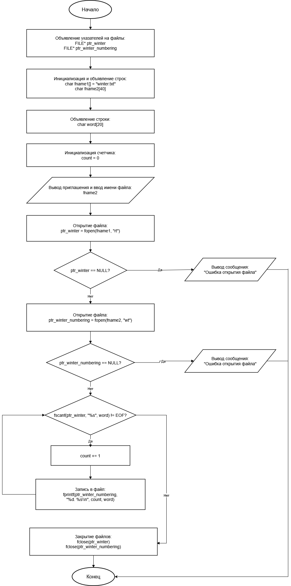
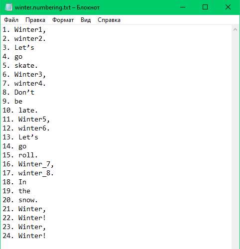

# Домашнее задание к работе 19

## Условие задачи
Считать текстовsй файл winter.txt и выполнить над тестом преобразование согласно варианту (полученный вариант текст записать новый файл с именем, указанным пользователем):
13. Пронумеровать все слова

    Содержимое файла winter.txt

     Winter1, winter2.

     Let’s go skate.

     Winter3, winter4.

     Don’t be lаte.

     Winter5, winter6.

     Let’s go rоll.

     Winter_7, winter_8.

     In the snow.

     Winter, Winter!

     Winter, Winter!

## 1. Алгоритм и блок-схема

### Алгоритм
1. **Начало**

2. **Конец**

### Блок-схема
 

## 2. Реализация программы

```
#define _CRT_SECURE_NO_WARNINGS
#include <stdio.h>
#include <locale.h>

int main(void) {

	setlocale(LC_CTYPE, "RUS");

	FILE* ptr_winter, * ptr_winter_numbering;
	
	char fname1[] = "winter.txt";
	char fname2[40];
	char word[20];
	int count = 0;

	printf("Введите новое имя файла: ");
	scanf("%s", fname2);

	if ((ptr_winter = fopen(fname1, "rt")) == NULL) { printf("Ошибка открытия файла"); return -1; }

	if ((ptr_winter_numbering = fopen(fname2, "wt")) == NULL) { printf("Ошибка открытия файла"); return -1; }


	while (fscanf(ptr_winter, "%s", word) != EOF) {

		count += 1;

		fprintf(ptr_winter_numbering,"%d. %s\n", count, word);
	}

	fclose(ptr_winter);
	fclose(ptr_winter_numbering);

	return 0;
}
```

## 3. Результаты работы программы

```
Введите новое имя файла: winter.numbering.txt
```
 

## 4. Информация о разработчике

Лупачев Сергей бТИИ-262
